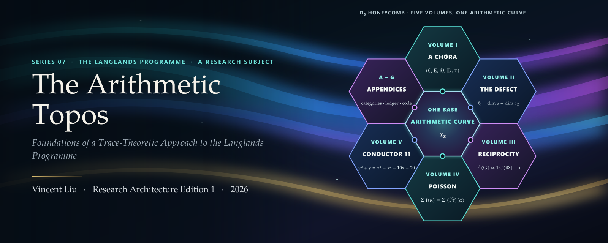
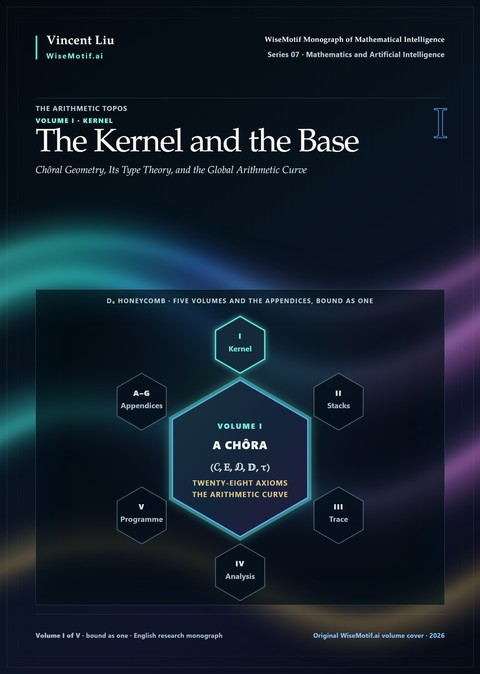
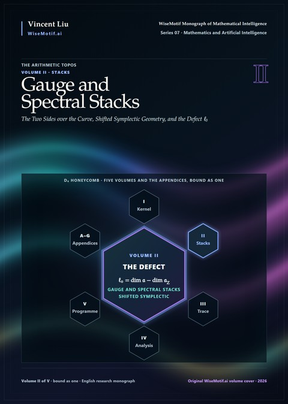
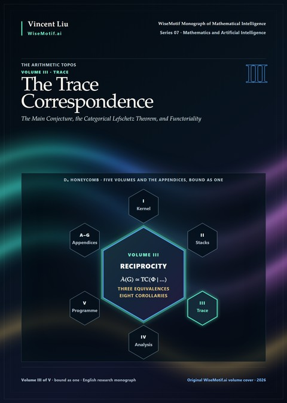
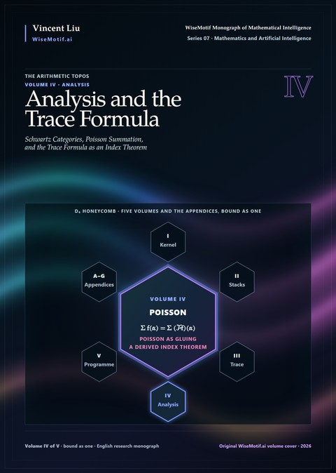
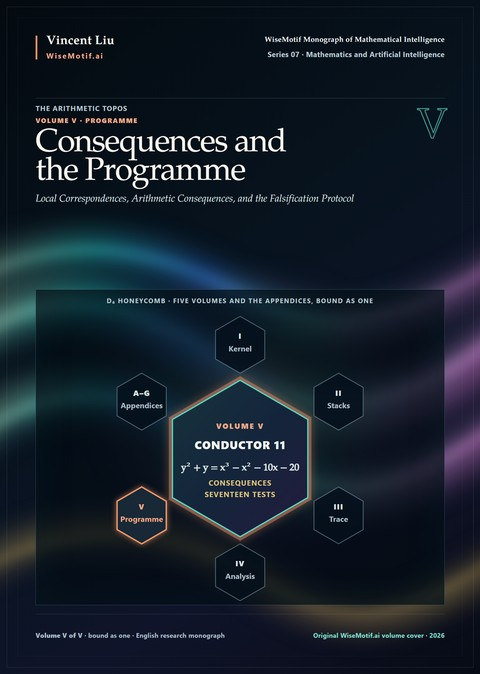
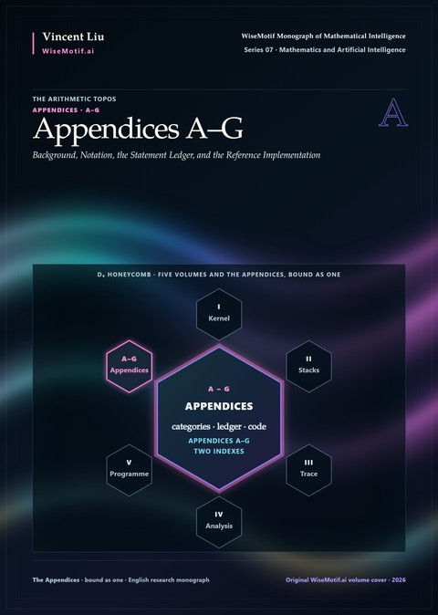
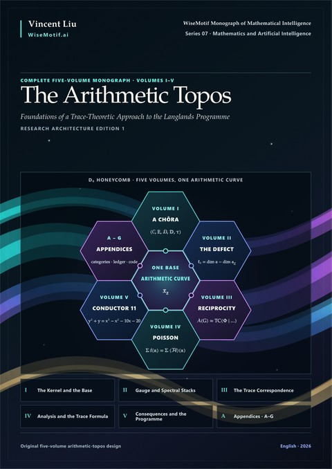

<p align="center">
  <a href="https://doi.org/10.5281/zenodo.23629681"></a>
</p>

<p align="center">
  <a href="https://doi.org/10.5281/zenodo.23629681"></a>
  <a href="https://creativecommons.org/licenses/by-nc-nd/4.0/"></a>
  <a href="code/LICENSE"></a>
  <a href="https://github.com/AlienMuse/the-arithmetic-topos/releases/tag/v1.0.0"></a>
  
  
  
  <a href="VERIFY.md"></a>
  <a href="VERIFY.md"></a>
</p>

<p align="center">
  <b><a href="https://github.com/AlienMuse/the-arithmetic-topos/releases/download/v1.0.0/The-Arithmetic-Topos-v1.0.0-Preview.pdf">Read the preview</a></b> (283 pages, 72.9 MB) ·
  <a href="#download">Download</a> ·
  <a href="#the-five-volumes">Volumes</a> ·
  <a href="#companion-code">Code</a> ·
  <a href="#citation">Cite</a> ·
  <a href="VERIFY.md">Verify</a> ·
  <a href="README.zh-CN.md">中文</a>
</p>

<br>

> *The Langlands correspondence is not a bijection. It is the value, at π₀, of a trace taken on a self-dual
> six-functor geometry over a single global base. The bijection is what remains when one forgets everything that
> made it true.*
> <br>— Preface

**The Arithmetic Topos** — *Foundations of a Trace-Theoretic Approach to the Langlands Programme* — is a monograph
in five volumes bound as one. It is the seventh work in the WiseMotif Monograph of Mathematical Intelligence and
belongs to the Grothendieckian Programme as a self-contained system: the Programme's fifth research subject, a
problem on which its method of recursive mathematical discovery is carried through in full. A structure is proposed;
it is tested against the cases in which the answer is known; what survives is abstracted and the question is posed
again, in the manner of Grothendieck's rising sea.

The problem is the Langlands programme, and the question is **why the Langlands correspondence can be proved over
function fields — where it is a theorem for GL<sub>n</sub>, and in the automorphic-to-Galois direction for every
reductive group — and remains open over number fields in general; and what object would let the function-field
proofs, which take traces of Frobenius over a curve, be imitated over ℤ.**

**The Langlands programme remains open over number fields beyond the cases that the literature has proved. This work
does not prove the Langlands correspondence, and no case of its Main Conjecture is established unconditionally in it**
(Proposition 40.4). What it offers is the state of the question after the method has been applied without
concession: what the arithmetic curve would deliver, what it would need, and where each route to it stops.

<table>
  <tr>
    <td align="center"><b>5</b><br><sub>volumes,<br>bound as one</sub></td>
    <td align="center"><b>7 · 40</b><br><sub>parts ·<br>chapters</sub></td>
    <td align="center"><b>2,001</b><br><sub>pages</sub></td>
    <td align="center"><b>1,609</b><br><sub>numbered statements,<br>each status-marked</sub></td>
    <td align="center"><b>111 · 53</b><br><sub>ledger items ·<br>conjectures</sub></td>
    <td align="center"><b>17 · 14</b><br><sub>falsification tests ·<br>research problems</sub></td>
    <td align="center"><b>120 · 280</b><br><sub>vector plates ·<br>references</sub></td>
  </tr>
</table>

## The idea: one base, one trace

Over a function field the programme has a base. The curve is a curve, its Frobenius is given by the arithmetic of the
field, and the correspondence is proved by taking traces of Frobenius on moduli of shtukas; in the geometric setting
the categorical correspondence itself has now been proved. Over ℤ there is no base: Spec ℤ is not a curve over
anything, it carries no Frobenius, and its archimedean place is invisible to sheaves.

Chapter 1 isolates four obstructions — the missing base, the missing trace, the missing archimedean place, and the
cohomological defect ℓ₀, which halts the Taylor–Wiles method for all but a thin class of groups and fields — and
argues that **they are one: the absence, over Spec ℤ, of a dualisable trace-theoretic geometry** (Principle 1.22, the
single-obstruction principle, marked as a design, not a theorem).

The book specifies that geometry. The **global arithmetic curve** 𝔛<sub>ℤ</sub> (Definition 10.15) is glued from the
syntomifications at the finite primes, whose local theory is established, and an archimedean chart built from
Simpson's twistor line, the Connes–Consani scaling flow and Deninger's Riemann flow, along an adelic period halo. It
carries a six-functor formalism with a primitive trace and an absolute Frobenius Φ whose trace is to compute the
automorphic spectrum. Its existence (Conjecture 10.16, GC.1), its effective halo descent (Conjecture 10.13) and its
orientation of degree three (Conjecture 12.14) are conjectures.

| The method | What the book does |
|---|---|
| **Diagnose** | six decades of theorems and where each stops; the curve of conductor eleven, over ℚ and over a function field; four obstructions shown to be one (Chapter 1) |
| **Found** | a geometry as a six-functor formalism with duality and a primitive trace — a chôra — by the axioms KH.1–KH.28, written in the modal directed type theory TT<sub>KH</sub> (Part I) |
| **Specify the base** | the finite charts (prismatisation, F-gauges), the archimedean chart (twistors, the scaling flow), the period halo and the gluing, the absolute Frobenius, the orientation of degree three (Part II) |
| **Build the two sides** | the arithmetic gauge and spectral stacks, shifted symplectic structure, the defect ℓ₀ and the structural failure of patching, derived Hecke algebras and Koszul duality, singular support (Part III) |
| **Conjecture** | the Main Conjecture with its three equivalences and eight corollaries; cyclotomic traces, the categorical Lefschetz theorem, the spectral action, functoriality as Fourier conjugation (Part IV) |
| **Analyse** | Schwartz categories, Poisson summation as a gluing axiom, the trace formula as a derived index theorem, Beyond Endoscopy, L-functions and Γ-factors, Eisenstein series (Part V) |
| **Test the consequences** | the p-adic and archimedean local correspondences, modularity, Fontaine–Mazur, Ramanujan and Arthur, special values (Part VI) |
| **Audit** | the constitution of the treatise, certified algorithms, the falsification protocol, the assessment and the programme ahead (Part VII) |

## The five volumes

The five volumes and the appendices are bound as one book. Each cover below places its volume at the centre of the
D₆ honeycomb, with the formula its cell carries on the front cover of the book.

<table>
  <tr>
    <td width="33%" valign="top" align="center">
      <a href="docs/contents/volume-i.md"></a><br>
      <b>I · The Kernel and the Base</b><br>
      <sub>Parts I–II · 12 chapters · pp. 1–466</sub><br><br>
      <sub>The problem and the thesis; a geometry as a six-functor formalism with duality and a primitive trace, by the axioms KH.1–KH.28, written in the type theory TT<sub>KH</sub>; the global arithmetic curve: the syntomic charts at the finite primes, the archimedean chart, the adelic halo that glues them, the absolute Frobenius and the orientation of degree three.</sub><br><br>
      <a href="docs/contents/volume-i.md">Contents</a> · <a href="https://github.com/AlienMuse/the-arithmetic-topos/releases/download/v1.0.0/The-Arithmetic-Topos-v1.0.0-Complete.pdf">PDF</a>
    </td>
    <td width="33%" valign="top" align="center">
      <a href="docs/contents/volume-ii.md"></a><br>
      <b>II · Gauge and Spectral Stacks</b><br>
      <sub>Part III · 6 chapters · pp. 467–703</sub><br><br>
      <sub>The two sides of the correspondence as stacks over the curve, their shifted symplectic geometry, the defect ℓ₀ and its structural explanation, the derived Hecke algebra and Koszul duality, and singular support.</sub><br><br>
      <a href="docs/contents/volume-ii.md">Contents</a> · <a href="https://github.com/AlienMuse/the-arithmetic-topos/releases/download/v1.0.0/The-Arithmetic-Topos-v1.0.0-Complete.pdf">PDF</a>
    </td>
    <td width="33%" valign="top" align="center">
      <a href="docs/contents/volume-iii.md"></a><br>
      <b>III · The Trace Correspondence</b><br>
      <sub>Part IV · 6 chapters · pp. 704–962</sub><br><br>
      <sub>The Main Conjecture with its three equivalences and eight corollaries, cyclotomic traces, the categorical Lefschetz theorem, the spectral action, the field-theoretic formulation, and functoriality as Fourier conjugation.</sub><br><br>
      <a href="docs/contents/volume-iii.md">Contents</a> · <a href="https://github.com/AlienMuse/the-arithmetic-topos/releases/download/v1.0.0/The-Arithmetic-Topos-v1.0.0-Complete.pdf">PDF</a>
    </td>
  </tr>
  <tr>
    <td width="33%" valign="top" align="center">
      <a href="docs/contents/volume-iv.md"></a><br>
      <b>IV · Analysis and the Trace Formula</b><br>
      <sub>Part V · 6 chapters · pp. 963–1225</sub><br><br>
      <sub>Schwartz categories, Poisson summation as a gluing axiom, the trace formula as a derived index theorem, Beyond Endoscopy and the deleted boundary, L-functions and Γ-factors, Eisenstein series and the continuous spectrum.</sub><br><br>
      <a href="docs/contents/volume-iv.md">Contents</a> · <a href="https://github.com/AlienMuse/the-arithmetic-topos/releases/download/v1.0.0/The-Arithmetic-Topos-v1.0.0-Complete.pdf">PDF</a>
    </td>
    <td width="33%" valign="top" align="center">
      <a href="docs/contents/volume-v.md"></a><br>
      <b>V · Consequences and the Programme</b><br>
      <sub>Parts VI–VII · 10 chapters · pp. 1226–1621</sub><br><br>
      <sub>The p-adic and archimedean local correspondences, modularity, Fontaine–Mazur, Ramanujan and Arthur, and special values; then the constitution of the treatise, the certified algorithms, the falsification protocol, and the assessment of what has and has not been achieved, with the research programme that follows.</sub><br><br>
      <a href="docs/contents/volume-v.md">Contents</a> · <a href="https://github.com/AlienMuse/the-arithmetic-topos/releases/download/v1.0.0/The-Arithmetic-Topos-v1.0.0-Complete.pdf">PDF</a>
    </td>
    <td width="33%" valign="top" align="center">
      <a href="docs/contents/appendices.md"></a><br>
      <b>Appendices A–G</b><br>
      <sub>7 appendices · bibliography · two indexes · pp. 1622–1954</sub><br><br>
      <sub>Higher categories, condensed and analytic mathematics, prismatic and syntomic cohomology and trace methods, in compressed but complete form; the notation; the statement ledger; and the reference implementation; indexes of notation and of statements.</sub><br><br>
      <a href="docs/contents/appendices.md">Contents</a> · <a href="https://github.com/AlienMuse/the-arithmetic-topos/releases/download/v1.0.0/The-Arithmetic-Topos-v1.0.0-Complete.pdf">PDF</a>
    </td>
  </tr>
</table>

<p align="center">
  <a href="https://github.com/AlienMuse/the-arithmetic-topos/releases/download/v1.0.0/The-Arithmetic-Topos-v1.0.0-Complete.pdf"></a><br>
  <b>The complete monograph</b> · Volumes I–V and Appendices A–G · 2,001 pages · 85.5 MB
</p>

## Selected results

Each item carries the status mark the book prints beside it.

- **The deficit is the defect (Theorem 16.14) *[ESTABLISHED]*, and patching fails structurally (Theorem 16.16)
  *[THEOREM]*.** For the minimal crystalline deformation problem of an absolutely irreducible ρ̄ into GL<sub>n</sub>
  over a number field (p > 2, with a parity condition at the real places), the generator–relation deficit g − r equals −ℓ₀. If ℓ₀ > 0, the patched ring has
  dim R<sub>∞</sub> = dim S<sub>∞</sub> − ℓ₀, the patched module is not free, and the argument cannot be repaired by
  enlarging S, by choosing different Taylor–Wiles primes, or by changing p, ρ̄ or the level.
- **The Main Conjecture (Conjecture 19.5) *[CONJECTURE]*.** For a connected reductive group G over a number field,
  under hypotheses listed by name,
  𝒜(G) ≃ TC(Φ ∣ Shv<sub>𝒩</sub>(Bun<sub>G</sub>(𝔛<sub>ℤ</sub>))) ≃ TC(Φ ∣ IndCoh<sub>𝒩</sub>(LocSys<sub>ᴸG</sub>(𝔛<sub>ℤ</sub>))) ≃ Γ(LocSys<sup>Φ</sup><sub>ᴸG</sub>, ω<sup>vir</sup>):
  the automorphic spectrum is the twisted cyclic trace of Frobenius on nilpotent sheaves on the gauge stack, on the
  spectral stack, and the virtual dualising sheaf on the Frobenius-fixed locus. The three arrows are three separate
  claims, MC1–MC3, each with its own refutation condition.
- **Eight corollaries, each with the hypotheses it consumes (Corollaries 19.17–19.24) *[CONJECTURE]*.**
  Reciprocity; functoriality as conjugation by a Fourier kernel; the archimedean Γ-factor as a regularised
  determinant; Ramanujan, purity and the Arthur SL<sub>2</sub>; Fontaine–Mazur as extension across the Hodge–Tate
  divisor; the Arthur–Selberg trace formula as an index theorem; local–global compatibility; special values as trace
  defects. Six of the eight are, in their classical formulations, open problems.
- **Local terms are vanishing cycles (Theorem 21.28, TR.8) *[THEOREM]*.** The localisation datum of the trace
  decomposes Tr(Φ ∣ IndCoh<sub>𝒩</sub>(Y)) over the components β of the fixed locus, with contribution
  Γ(β, 𝒫<sub>β</sub>), the sections of the perverse sheaf of vanishing cycles; its Euler characteristic is Behrend's
  weighted count, which replaces the Atiyah–Bott denominator in the singular and derived setting.
- **Poisson summation is halo descent (Theorem 26.7) *[THEOREM]*.** A globally coherent local Fourier datum
  satisfies the cocycle condition on the adelic halo; if the halo-descent Conjecture 10.13 holds for the cover it is
  effective, and the descended involution is characterised by Σ f(α) = Σ (ℱf)(α), α ∈ F.
- **Functoriality as Fourier conjugation (Conjecture 24.20) *[CONJECTURE]*.** For every L-homomorphism
  η: ᴸH → ᴸG satisfying the stated finiteness and anomaly conditions, the transfer is
  Lift<sub>η</sub> = ℱ<sup>−1</sup><sub>L,G</sub> ∘ Rη<sub>∗</sub> ∘ ℱ<sub>L,H</sub>.
- **The fatal triple (Corollary 39.27) *[THEOREM]*.** Each of Tests 1, 5 and 6 of the falsification protocol refutes
  the Main Conjecture on failure; their simultaneous failure leaves nothing standing.
- **The counts, corrected (Proposition 40.3) and no unconditional case (Proposition 40.4) *[THEOREM]*.** The ledger
  holds 111 items, 83 entries and 28 axioms: 53 conjectures, 24 theorems of the framework, 15 established results,
  25 designs. There is no pair (F, G), not even F = ℚ and G = 𝔾<sub>m</sub>, for which the book exhibits the
  equivalence of Conjecture 19.5 with all three arrows constructed and all hypotheses discharged.

## What this work is — and is not

**It is** a framework: a foundational system, a construction of the objects that system requires, a precise
formulation of the correspondence within it, an explicit inventory of what must be proved, and a computational and
formal-verification programme by which the inventory might be discharged. Every numbered statement carries one of five
marks, printed beside its number: **[ESTABLISHED]** a theorem of the existing literature, or a result proved here in
full from such theorems; **[THEOREM]** a theorem of the framework, proved here from stated axioms; **[CONJECTURE]**
not proved, here or elsewhere; **[DESIGN]** a definition, construction or design principle, which carries no truth
claim; **[FORMAL TARGET]** stated so that a proof assistant could check it, and not yet machine-checked. Of the 1,609
numbered statements, 675 are established, 234 theorems of the framework, 207 conjectures, 482 designs and 11 formal
targets (Index of Statements). Every chapter contains at least one block marked *Caveat*, placed where the chapter is
weakest rather than where it is strongest.

**It is not** a proof of the Langlands correspondence. The Main Conjecture is marked [CONJECTURE], and no case of it
is proved unconditionally anywhere in the book. It proves no new case of modularity, no new case of functoriality, no
instance of the Ramanujan conjecture, and nothing whatever about the location of the zeros of any L-function. The 24
theorems of the ledger are each conditional on at least one axiom or on the existence conjecture GC.1; Chapter 40
names four results that would survive the collapse of the framework around them — the categorical Lefschetz theorem
in the form of Theorem 21.28, the trace rigidity theorem of Chapter 20, the computation of the archimedean regularised
determinant behind Theorem 9.27, and the local structure theory of matrix factorisations assembled in Chapter 17.
Nothing in the software asserts a mathematical fact, and the Lean 4 statement skeleton is not yet compiled.

## Where to start

Chapter 1 is a complete account of the whole architecture; §1.5 and §1.6 state the Main Conjecture informally and
list what the book claims and what would falsify it. *How to Read This Book* gives four routes.

| Route | Chapters |
|---|---|
| the sceptic's, which the book recommends | 40, the assessment; Appendix F, the ledger; 39, the falsification protocol; then 1 |
| the arithmetician's | 1; 7; 16; 19; 33–36; 40 |
| the categorist's | 2–6; 12, 15, 18; 19–23; Appendix A |
| the computational | 37; 38; Appendix G; then the aletheia source tree |

The [preview](https://github.com/AlienMuse/the-arithmetic-topos/releases/download/v1.0.0/The-Arithmetic-Topos-v1.0.0-Preview.pdf) contains the front matter — Series Note, Abstract,
Preface, Acknowledgements, How to Read This Book, Notation and Conventions, the contents and the list of plates — and
the whole of Part I, Chapters 1–6.

## Download

| File | Pages | Size |
|---|---:|---:|
| [**Complete monograph**](https://github.com/AlienMuse/the-arithmetic-topos/releases/download/v1.0.0/The-Arithmetic-Topos-v1.0.0-Complete.pdf) — Volumes I–V and Appendices A–G | 2,001 | 85.5 MB |
| [Preview](https://github.com/AlienMuse/the-arithmetic-topos/releases/download/v1.0.0/The-Arithmetic-Topos-v1.0.0-Preview.pdf) — front matter and Part I | 283 | 72.9 MB |
| [Companion code](https://github.com/AlienMuse/the-arithmetic-topos/releases/download/v1.0.0/The-Arithmetic-Topos-v1.0.0-code.zip) — aletheia and the Lean 4 statement skeleton, Apache-2.0 | — | 93.7 KB |

The same files, with identical checksums, are archived at Zenodo: [doi:10.5281/zenodo.23629682](https://doi.org/10.5281/zenodo.23629682).
Covers are 600 ppi full-bleed; all fonts are embedded; the PDFs are linearised for fast opening.

## Companion code

[`code/`](code/) is the companion code of the book, as published in the code archive of the release.

- **aletheia** ([`code/aletheia/`](code/aletheia/)), the reference implementation: an engineering model of the
  interfaces, finite algorithms and evidence discipline of Part VII — finite kernels for traces and weights, Satake and
  Hecke data, Galois defect counts, Newton and Hodge polygons, orbital sums, certificates, the status lattice and the
  evidence ledger. It uses the Python standard library only, and its 21 tests pass. It implements some finite kernels
  and represents the other objects of the book only by metadata or interfaces; a successful computation supplies
  finite evidence or a checked finite identity, while only an external mathematical proof or a proof-assistant
  kernel may establish a general theorem. Appendix G records what it does and does not yet do.
- **The Lean 4 statement skeleton** ([`code/lean/`](code/lean/)): the formal targets as Lean statements, with
  thirty-three open placeholders (`sorry`); not yet compiled.

```sh
cd code
python -m pytest tests -q                               # the 21 tests (pytest required)
python -m aletheia selfcheck                            # eight finite self-checks
python -m aletheia defect --group GL2 --field "Q(i)"    # the defect ℓ₀ of a Bianchi group
python -m aletheia lfunction --curve 11a1 --terms 200   # the curve of conductor eleven
```

`REPRODUCIBILITY.md` compares the numbers the book prints with the output of the tests and of the numerical
verification scripts; `CODE-EDITS.md` lists the documentation edits made for publication (no line of program code
changes). Appendix G and Chapter 38 describe an earlier audited snapshot of version 0.1.0, in which a syntax error in
the evidence-ledger module blocked import and two tests failed; in the code published here those defects are absent
and all 21 tests pass. The code is licensed under the Apache License 2.0 ([code/LICENSE](code/LICENSE)); the book is not.

## Citation

> Liu, V. (2026). *The Arithmetic Topos — Foundations of a Trace-Theoretic Approach to the Langlands Programme*
> (Research Architecture Edition 1, version 1.0.0). Zenodo. https://doi.org/10.5281/zenodo.23629681

```bibtex
@book{liu2026arithmetictopos,
  author    = {Liu, Vincent},
  title     = {The Arithmetic Topos --- Foundations of a Trace-Theoretic Approach to the {Langlands} Programme},
  series    = {WiseMotif Monograph of Mathematical Intelligence, Series 07},
  edition   = {Research Architecture Edition 1},
  version   = {1.0.0},
  year      = {2026},
  publisher = {Zenodo},
  doi       = {10.5281/zenodo.23629681},
  url       = {https://doi.org/10.5281/zenodo.23629681}
}
```

GitHub's *Cite this repository* button uses [CITATION.cff](CITATION.cff). The concept DOI 10.5281/zenodo.23629681 always resolves to
the latest version; cite the version DOI 10.5281/zenodo.23629682 to refer to these exact files.

## Authenticity

Every file of the release is listed in `SHA256SUMS`, signed with OpenPGP and timestamped twice (RFC 3161 and
OpenTimestamps on Bitcoin). The signing key is the same as for Series 01–06.

Signing key fingerprint: `DA1A 1AEF D8B2 C17C FF3F 1D1B 3905 0F50 7A4F EC17`

GitHub releases of this repository are immutable. Copies obtained elsewhere that do not match `SHA256SUMS` are not
authentic. Three levels of verification: [VERIFY.md](VERIFY.md).

## License and AI use

The work is licensed under [CC BY-NC-ND 4.0](LICENSE): you may share it unchanged, with attribution, for
non-commercial purposes. Translations and other uses require written permission. As the copyright page states, the
code listings printed in the work and the companion code that accompanies it — the aletheia reference implementation
and the Lean 4 statement skeleton — are additionally available under the [Apache License 2.0](LICENSES/Apache-2.0.txt).
Details: [NOTICE.md](NOTICE.md) · Name use: [TRADEMARKS.md](TRADEMARKS.md).

**Text and data mining rights are reserved** under Article 4(3) of Directive (EU) 2019/790. Training or fine-tuning
machine-learning models on the work is not permitted without written permission. Individual readers may use AI
tools to read, search, explain or translate the work for their own study. Full policy:
[TDM-AND-AI-POLICY.md](TDM-AND-AI-POLICY.md).

## Contributing

The last section of Chapter 40 is addressed to the reader who thinks the framework is wrong: a well-aimed refutation
is worth more to the author than a decade of sympathetic elaboration. It asks that the twenty-four theorems and the
derivations be attacked rather than the conjectures, whose being unproved is stated, not concealed. Three kinds of
contribution matter most:

- **Refutation** — any of the seventeen tests of the falsification protocol of Chapter 39, each of which names the
  statements that die if it fails. The cheapest are named: the orientation degree of Conjecture 12.14 (problem P1),
  ℓ₀ computed two ways in the Bianchi case (P3), and a proof that the archimedean obstruction is a theorem.
- **Construction** — any of the fourteen research problems of Chapter 40, or one of the four hardest gaps it treats
  at length: a construction of the base, an ambidexterity theorem, a six-functor formalism at the archimedean place, and the
  foundations of traces on large categories.
- **Reproduction** — an independent check of aletheia against the book's tables, or a compiled Lean statement in
  place of one of the thirty-three placeholders.

A status mark may be downgraded, a statement withdrawn, an axiom shown inconsistent with another: the ledger is
designed to accept such a change as a normal operation. Report errors through an
[errata issue](https://github.com/AlienMuse/the-arithmetic-topos/issues/new?template=errata.yml). Accepted corrections are acknowledged by name in the next
edition (see [ERRATA.md](ERRATA.md)).

---

<p align="center"><sub>
  <a href="https://wisemotif.ai">WiseMotif Monograph of Mathematical Intelligence</a> · Series 07 · Mathematics and Artificial Intelligence<br>
  Series 01: <a href="https://github.com/AlienMuse/grothendieckian-machine"><i>GAI-MUA: The Grothendieckian Machine</i></a> ·
  Series 02: <a href="https://github.com/AlienMuse/topos-native-intelligence"><i>GM-Omega-Infinity: Topos-Native Intelligence</i></a> ·
  Series 03: <a href="https://github.com/AlienMuse/arithmetic-spectral-descent"><i>Arithmetic Spectral Descent</i></a> ·
  Series 04: <a href="https://github.com/AlienMuse/fractured-adelic-geometry"><i>Fractured Adelic Geometry</i></a> ·
  Series 05: <a href="https://github.com/AlienMuse/the-archimedean-prism"><i>The Archimedean Prism</i></a> ·
  Series 06: <a href="https://github.com/AlienMuse/strained-prismatic-geometry"><i>Strained Prismatic Geometry</i></a><br>
  © 2026 Vincent Liu
</sub></p>
